<div align="center">

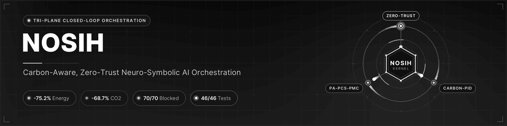

# NOSIH: A Carbon-Aware, Zero-Trust Neuro-Symbolic Orchestration System for Energy-Efficient Agentic AI

**Closed-Loop Tri-Plane Kernel Unifying Tool-Boundary Cryptographic Isolation (Plane I), Diurnal Carbon-Conformal Routing & Provenance-Scoped Caching (Plane II), and Deterministic CPU Offload & Predictive Multi-State GPU Power Control (Plane III)**

[](results/tests/test_suite_summary.json)
[](results/verification/claim_evidence_matrix.json)
[](paper/nosih_paper.pdf)
[](pyproject.toml)
[](SECURITY.md)
[](LICENSE)

*Author:* **Gokulraman B** (`gokulrmn2178@gmail.com`) · *Affiliation:* Department of Artificial Intelligence and Data Science, Rajalakshmi Institute of Technology, Chennai, India

[IEEE Paper (PDF)](paper/nosih_paper.pdf) · [Architecture & Logic Guide (DOCX)](docs/NOSIH_Architecture_and_Logic_Guide.docx) · [Verification Status](VERIFICATION_CHECKLIST_STATUS.md) · [Security Policy](SECURITY.md) · [Cite NOSIH](#9-citation-author--license)

</div>

---

### Headline Verified Results at a Glance

| Evaluation Dimension | Primary Metric | Measured NOSIH Result | Comparison / Statistical Rigor |
| :--- | :--- | :---: | :--- |
| **Active Energy** | 240-Prompt Diurnal Total | **$-75.2\%$** (`0.005567` vs. `0.022479 kWh`) | $p = 1.26 \times 10^{-38}$, $r_{\text{rb}} = 0.9678$; $-18.5\%$ vs. Fixed-Threshold ($p = 1.15 \times 10^{-13}$) |
| **Operational Carbon** | 240-Prompt Diurnal $\text{CO}_2$ | **$-68.7\%$** (`2.1728` vs. `6.9487 g`) | $p = 1.43 \times 10^{-37}$, $r_{\text{rb}} = 0.9539$; $-18.2\%$ vs. Fixed-Threshold ($p = 2.36 \times 10^{-12}$) |
| **Latency & Cost** | Mean Latency / Total Cost | **$-67.8\%$** (`707.6 ms`) / **$-63.1\%$** (`$0.024826`) | $p = 2.69 \times 10^{-37}$ / $p = 7.86 \times 10^{-39}$; 3-seed SD $\le 0.74\%$ |
| **Goal-Normalized Efficiency** | Task Success & Energy/Goal | **$97.50\%$** (`0.02379 Wh/goal`, **$-75.3\%$**) | Exceeds Static Large (`97.08%`) and Fixed-Threshold Router (`90.83%`) |
| **Idle GPU Power** | PCS-PMC 3-State Sleep | **$-79.35\%$** (`33.6677 Wh` net saved) | `68` vs. `94` wakeups ($-27.7\%$ thrashing); `257.8 ms` average wake latency |
| **Zero-Trust Security** | 100-Case 10-Family Suite | **$70/70$ Blocked (`0.0%` FNR) · $30/30$ Benign (`0.0%` FPR)** | 95% Wilson CI $[94.80\%, 100.0\%]$; `2.714 ms` mean / `3.593 ms` P95 proxy overhead |
| **Distribution Shift Risk** | 5-Seed Online Conformal PID | **$5.30\% \pm 0.12\%$** post-shift error | `74.12% ± 1.17%` coverage vs. `28.88% ± 1.41%` static error ($p = 9.90 \times 10^{-40}$) |
| **Cross-Plane Defenses** | PCSP · PA-PCS-PMC · CCEC | **$-96.9\%$ C-DoW $\text{CO}_2$ · $-100.0\%$ Sleep-DoS · $240/240$ CCEC** | `50/50` C-DoW mitigated · `0.0 J` vs. `7000.0 J` wasted · `20/20` tamper & `20/20` spoof caught |

---

### Table of Contents

1. [Executive Summary & The Sustainability–Reliability–Security Trilemma](#1-executive-summary--the-sustainabilityreliabilitysecurity-trilemma)
2. [Literature Positioning & 11-Capability Gap Matrix](#2-literature-positioning--11-capability-gap-matrix)
3. [How We Conducted This Research (End-to-End Methodology)](#3-how-we-conducted-this-research-end-to-end-methodology)
4. [Architectural Deep-Dive: Tri-Plane Kernel, 7-Stage Lifecycle & Cross-Plane Novelties](#4-architectural-deep-dive-tri-plane-kernel-7-stage-lifecycle--cross-plane-novelties)
5. [Interactive Visual Gallery of Animated Simulations](#5-interactive-visual-gallery-of-animated-simulations)
6. [Comprehensive Empirical Evaluation & Statistical Results](#6-comprehensive-empirical-evaluation--statistical-results)
7. [Threats to Validity, Scope of Security Claims & GPU Hardware Roadmap](#7-threats-to-validity-scope-of-security-claims--gpu-hardware-roadmap)
8. [Repository Architecture, Quickstart, One-Command Reproduction & Artifact Index](#8-repository-architecture-quickstart-one-command-reproduction--artifact-index)
9. [Citation, Author & License](#9-citation-author--license)

---

## 1. Executive Summary & The Sustainability–Reliability–Security Trilemma

Modern agentic AI deployments elevate Large Language Models (LLMs) from single-turn text generators into autonomous multi-step planners that invoke enterprise databases, ERP ledgers, financial APIs, and webhooks over the **Model Context Protocol (MCP)**. Moving from passive chat to tool-using execution exposes a tightly coupled **Sustainability–Reliability–Security Trilemma** at the orchestration layer:

1. **The Sustainability Axis (Compute & Idle Residency Waste):** A single user request in an agentic workflow frequently triggers dozens of planning, tool-invocation, and verification calls. Routing deterministic arithmetic, structured policy retrieval, or signal processing to a $175\text{ W}$ GPU model burns orders of magnitude more energy than a $<5\text{ W}$ CPU symbolic operator. Simultaneously, pinning idle model weights in GPU VRAM consumes $18\text{--}45\text{ W}$ per tier between traffic bursts while regional electricity grid carbon intensity swings $2.7\times\text{--}5.9\times$ intraday.
2. **The Security Axis (Tool-Boundary Compromise):** Connecting probabilistic planners to privileged MCP tools with ambient credentials creates severe attack surfaces: indirect prompt injection (IPI) embedded in vendor emails or retrieved documents, Day-0 tool-description poisoning, mid-session schema rug pulls, concurrent capability replay, multi-payout double-spend races, encoded confidentiality egress (Base64/hex/chunked), and cross-tenant semantic cache poisoning. Prompt-level alignment alone cannot enforce hard authorization invariants across untrusted tool boundaries.
3. **The Reliability Axis (Non-Stationary Drift):** Production agent workloads are non-stationary—document corpora rotate, model calibration drifts, and serving backends experience latency spikes. Static routing thresholds and offline split-conformal calibration collapse under distribution shift, either violating carbon/latency budgets or accepting overconfident errors.

### Why Decoupled Point Solutions Fail

Bolting independent point solutions together—such as placing a security proxy in front of an energy router and a reactive GPU sleep controller—leaves structural vulnerabilities that only emerge across plane boundaries:
* A **semantic cache blind to cryptographic provenance** allows low-integrity or cross-tenant entries to poison downstream privileged queries.
* A **carbon router blind to provenance taint** suffers **Carbon-Denial-of-Wallet (C-DoW)**: adversaries embed complex-looking filler in untrusted documents during fossil-heavy evening grid peaks ($450\text{--}515\text{ gCO}_2\text{eq/kWh}$) to force $175\text{ W}$ GPU dispatch.
* A **reactive GPU sleep manager blind to authorization** suffers **Sleep-Thrashing DoS**: unauthorized requests trigger costly VRAM-to-RAM wakeups ($175\text{ J}$ each) before failing security checks.

### Core Contributions (C1–C6)

**NOSIH** resolves this trilemma by unifying all three planes inside a single closed-loop kernel (`ZeroTrustKernel`), binding every cache key, routing decision, DAG hop, and GPU power state transition to shared cryptographic provenance labels and online primal-dual telemetry:

* **C1 — Unified Tri-Plane Kernel:** Single closed-loop orchestration runtime coupling Zero-Trust Security (**Plane I**), Carbon-Conformal Control (**Plane II**), and Durable Neuro-Symbolic Execution & Power Control (**Plane III**).
* **C2 — Anti-Spoofing 10D Profiler & Provenance-Scoped Semantic Cache (`PS-RCSC`):** Sub-millisecond CPU feature extractor paired with a provenance-partitioned float32 BLAS semantic cache featuring cost-aware deterministic bypass (`0.018 ms`), polarity/numeric guards, and Channel-2 Conformal admission.
* **C3 — Carbon-Aware Primal-Dual Routing (`CA-DPD-LinUCB`) & Dual-Channel Conformal PID:** Discounted linear contextual bandit with online Lagrangian dual multipliers over diurnal grid carbon $C(t)$, energy, and latency budgets, stabilized by distribution-free Online Conformal PID ($\alpha = 0.05$).
* **C4 — Non-Bypassable Zero-Trust Reference Monitor (`CAT-PLM`):** Strict RFC 8785 JCS canonicalization, out-of-band HMAC-SHA256 signed boot manifests, offline-attenuable `SPCCE-Macaroon` capabilities with SQLite WAL single-use `jti` replay locks, `POST-W++` Integrity $\times$ Confidentiality provenance semiring with exact-`Decimal` linear budgets, and an RFC 6962/9162 binary Merkle Transparency Log (`MTLog`).
* **C5 — Predictive Multi-State Power Control (`PCS-PMC`) & Reproducible Verification:** Break-even EWMA-hysteresis three-state GPU sleep controller verified across a 240-prompt 3-seed diurnal benchmark, 7-condition ablation, 100-case 10-family security suite, 5-seed shift study, and `46/46` automated tests.
* **C6 — Three Irreducible Cross-Plane Primitives:**
  1. **PCSP (Provenance-Coupled Carbon-Security Pricing):** Cuts C-DoW adversarial emissions by **96.9%** (`50/50` mitigated).
  2. **PA-PCS-PMC (Pre-Authorized, Carbon-Modulated Sleep Control):** Cuts Sleep-Thrashing DoS wakeup waste by **100.0%** (`0.0 J` vs. `7000.0 J`, `n=40`).
  3. **CCEC (Cryptographic Carbon-Attested Execution Certificates):** Commits Scope-2 footprints into `MTLog` with $O(\log N)$ Merkle auditability (`240/240` verified in `7.93` mean / `8` max hashes (`7–8` range), `20/20` tamper detection, `20/20` simulated-as-hardware spoof rejection).

---

## 2. Literature Positioning & 11-Capability Gap Matrix

Prior literature advances individual axes—offline model compression (Green AI), multi-agent orchestration (Agentic AI), temporal workload shifting (Carbon-Aware Schedulers), cost-driven cascades (LLM Routers), and planner control/data separation (Agent Security)—without unifying cryptographic provenance, diurnal carbon optimization, online conformal risk control, and predictive GPU sleep inside one closed loop.

| Architectural Capability | Green AI *(Strubell et al., Schwartz et al., Han et al.)* | Agentic AI *(AutoGen, MetaGPT)* | Carbon-Aware *(Carbon-Aware Batch, EcoServe, GreenCache, GAR)* | LLM Routers *(FrugalGPT, RouterBench, RouteLLM)* | Agent Security *(CaMeL, FIDES, Progent, MCPTox)* | **NOSIH (Ours)** |
| :--- | :---: | :---: | :---: | :---: | :---: | :---: |
| 1. Dynamic Neuro-Symbolic Routing | ❌ | 🟡 Partial | ❌ | 🟡 Partial | ❌ | ✅ **Full** |
| 2. Dynamic Diurnal Carbon Optimization | 🟡 Partial | ❌ | ✅ Full | ❌ | ❌ | ✅ **Full** |
| 3. Predictive Multi-State Sleep (EWMA Hysteresis) | 🟡 Partial | ❌ | 🟡 Partial | ❌ | ❌ | ✅ **Full** |
| 4. Tool-Boundary IPI Isolation / IFC Lattice | ❌ | ❌ | ❌ | ❌ | ✅ Full | ✅ **Full** |
| 5. Cryptographic Capabilities & Merkle Audit | ❌ | ❌ | ❌ | ❌ | 🟡 Partial | ✅ **Full** |
| 6. Online Conformal Risk Control ($\alpha = 0.05$) | ❌ | ❌ | ❌ | ❌ | ❌ | ✅ **Full** |
| 7. Provenance-Scoped Semantic Caching (`PS-RCSC`) | ❌ | ❌ | 🟡 Partial | 🟡 Partial | ❌ | ✅ **Full** |
| 8. C-DoW Carbon-Security Pricing (`PCSP`) | ❌ | ❌ | ❌ | ❌ | ❌ | ✅ **Full** |
| 9. Cryptographic Carbon Certificates (`CCEC`) | ❌ | ❌ | ❌ | ❌ | ❌ | ✅ **Full** |
| 10. Pre-Auth Sleep-Thrashing Defense (`PA-PCS-PMC`) | ❌ | ❌ | ❌ | ❌ | ❌ | ✅ **Full** |
| 11. Unified Closed-Loop Tri-Plane Kernel | ❌ | ❌ | ❌ | ❌ | ❌ | ✅ **Full** |

---

## 3. How We Conducted This Research (End-to-End Methodology)

<p align="center">
  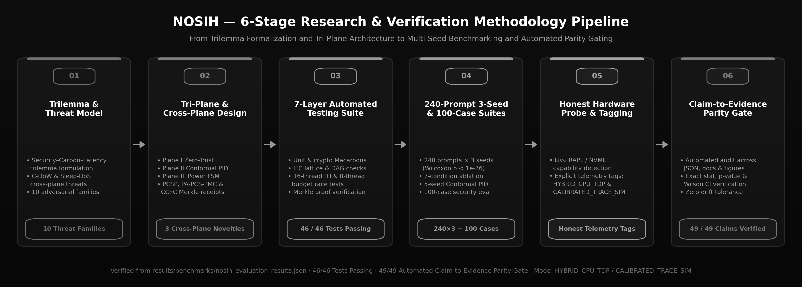
</p>

NOSIH was engineered and validated through a six-stage, reproducibility-first research methodology where every theoretical invariant, software module, empirical table, and paper claim is locked together by automated verification gates:

### Stage 1: Problem Decomposition & Adversarial Threat Modeling
We formalised the Trusted Computing Base (TCB) strictly around the NOSIH kernel (`jcs_v3`, `proxy_v3`, `spcce_v3`, `postw_v3`, `merkle_log`, `shadow_v3`), the out-of-band signed boot manifest, and the SQLite WAL state store. All LLM planners, retrieved documents, external MCP servers, and wire JSON-RPC 2.0 frames are treated as untrusted. We systematically modeled **10 adversarial attack families** spanning both classic tool-boundary exploitation and cross-plane sustainability attacks:
1. Linear monetary budget exhaustion & concurrent split-payout races
2. Encoded confidentiality egress (Base64, hex, chunked, and high-entropy exfiltration)
3. JSON parser-differential attacks (duplicate keys, non-finite floats, lone UTF-16 surrogates, missing capabilities)
4. Multi-hop Indirect Prompt Injection (IPI) across chained DAG nodes
5. Integrity lattice escalation (e.g., untrusted inputs mutating ERP bank-master records)
6. Unallowlisted egress webhook endpoints
7. Macaroon capability scope & hop forgery / concurrent 16-thread `jti` replay
8. Cross-tenant & cross-epoch semantic cache poisoning
9. Malicious cyclic DAGs and static Information Flow Control (IFC) violations
10. Day-0 / mid-session schema rug pulls and Merkle audit-log truncation/tampering—extended with **C-DoW**, **Sleep-Thrashing DoS**, and **ESG Scope-2 accounting spoofing**.

### Stage 2: First-Principles Tri-Plane Design & Formal Theorem Derivation
Before benchmarking, we derived five formal theorems establishing cryptographic non-escalation, transactional replay/budget soundness, multi-hop IFC and Merkle tamper evidence, dynamic bandit regret and distribution-free conformal risk bounds, and cross-plane non-decomposability.

<details>
<summary><strong>Click to expand Formal Theorems 1–5 & Proof Sketches</strong></summary>

* **Theorem 1 (Non-Escalation & Monotonic Attenuation):** Under EUF-CMA security of HMAC-SHA256 ($\lambda = 256$ bits), given a valid Macaroon $C_k = (\text{header}, [c_1, \dots, c_k], \sigma_k)$, no PPT adversary without $K_{s,u}$ can forge an accepted $C'$ authorizing $r \notin \bigcap_{i=1}^k \mathcal{A}(c_i)$ with probability exceeding $\text{Adv}^{\text{EUF-CMA}}_{\text{HMAC}}(\lambda) + 2^{-\lambda}$.  
  *Proof Sketch:* Dropping or modifying any caveat $c_j$ ($j \le k$) or `header` requires forging an HMAC under unknown intermediate key $\sigma_{j-1}$ or colliding SHA-256; appending caveats only shrinks $\bigcap \mathcal{A}(c_i)$. $\square$

* **Theorem 2 (Concurrent Replay & Linear Budget Soundness):** Under SQLite WAL `BEGIN IMMEDIATE` serialization and 128-bit CSPRNG JTIs, across any $T$ concurrent threads: (a) at most one call per unique `jti` executes; and (b) for any witness $w$ with exact-`Decimal` budget $B_w$, total payouts satisfy $\sum_j a_j \le B_w$.  
  *Proof Sketch:* `BEGIN IMMEDIATE` acquires a `RESERVED` write lock prior to reads, serializing `PRIMARY KEY (jti)` inserts and inductive exact-`Decimal` updates $0 \le \text{rem}_t = B_w - \sum_{j \le t} a_j$. $\square$

* **Theorem 3 (Multi-Hop IFC Soundness & Tamper Evidence):** Over any acyclic DAG $G = (V, E)$, any `UNTRUSTED` ancestor forces $\ell_{\mathcal{I}}(u) = \text{UNTRUSTED}$ (blocking trusted sinks), and any ancestor with $\ell_{\mathcal{C}}(v) \not\sqsubseteq_{\mathcal{C}} \text{clear}(e)$ blocks egress $e$. Under SHA-256 collision resistance and `0x00`/`0x01` domain separation, modifying or truncating any leaf $i < m$ fails `MTLog` verification against witnessed $\text{STH}_m$ in $O(\log N)$ time.  
  *Proof Sketch:* Immediate by topological induction via absorptivity of $\sqcup_{\mathcal{I}}, \sqcup_{\mathcal{C}}$ and collision reduction at the lowest differing Merkle node. $\square$

* **Theorem 4 (Dynamic Regret, Feasibility & Risk Control):** Under variation budget $B_T$ and Slater margin $\rho > 0$, `CA-DPD-LinUCB` achieves $\widetilde{\mathcal{O}}(d^{2/3} B_T^{1/3} T^{2/3} + \rho^{-1}\sqrt{MT})$ dynamic regret and sublinear constraint violation. Under arbitrary distribution shift, Online Conformal PID bounds long-run selective risk by $\alpha + \mathcal{O}(1/(\eta T))$. $\square$

* **Theorem 5 (Cross-Plane Non-Decomposability & C-DoW Bound):** Under any decoupled security-blind router and reactive sleep manager, $K$ untrusted peak-hour prompts induce worst-case energy $K(E_{T_3} + E_{\text{wake}})$. Under `PCSP + PA-PCS-PMC`, unauthorized hops incur $0.0\text{ J}$ wakeup energy, unauthenticated untrusted prompts are bounded by $K E_{T_1}$ (or $K E_{T_{0\text{b}}}$), and every footprint is committed in $O(\log N)$ CCEC proofs. $\square$

</details>

### Stage 3: 7-Layer Test-Driven Engineering (`46/46` Tests, `0.997 s`)
Every component was built against an automated 7-layer verification harness (`tests/run_all_tests.py`) that runs deterministically in under 1 second:

| Layer | Suite Directory | Verification Scope |
| :---: | :--- | :--- |
| **1** | `tests/unit/` | RFC 8785 JCS edge cases (duplicate keys, floats, UTF-16 surrogates), property-based key permutation & provenance semiring algebraic laws, AST sandbox fuzzing, fail-closed policy loading |
| **2** | `tests/crypto/` | Offline-attenuable Macaroons, HKDF-SHA256 session derivation, concurrent SQLite WAL `jti` replay locks, RFC 6962/9162 Merkle inclusion/consistency proofs & shadow receipts |
| **3** | `tests/security/` | Independent RFC 8785 vectors, cross-tenant/cross-session isolation, SQLite restart `jti` recovery, atomic exact-`Decimal` budget rollback, Day-0 poisoned manifest & mid-session rug pulls, multi-hop taint & Base64/hex egress |
| **4** | `tests/control/` | `CA-DPD-LinUCB` non-stationary adaptation & primal-dual knapsack budgets, Dual-Channel Conformal PID under shift, 10D anti-spoofing profiler, `PS-RCSC` provenance scoping & cost-aware bypass |
| **5** | `tests/execution/` | Static Kahn + abstract-interpretation IFC DAG verifier, hard `asyncio.wait_for` timeout cancellation, bit-identical deterministic replay, chaos circuit-breaker failover, corrupted SQLite journal detection, cache TTL & policy-epoch invalidation |
| **6** | `tests/integration/` | End-to-end `ZeroTrustKernel` AST/RAG/FFT/Merkle trail, explicit 7-stage lifecycle trace, async concurrency load tests (`10 / 50 / 100` concurrent requests), hardware environment probe |
| **7** | `tests/power/` | Multi-day diurnal carbon MAE/RMSE & stale-telemetry fallback, `PCS-PMC` EWMA hysteresis vs. fixed-timeout wakeup reduction, analytical 1024 Hz FFT & Sobel ground truth, cross-plane `PCSP`/`PA-PCS-PMC`/`CCEC` tests |

### Stage 4: Multi-Seed Statistical Benchmark Design
Our evaluation harness (`experiments/run_nosih_evaluation.py`) avoids single-run cherry-picking by enforcing:
* **240-Prompt Six-Category Workload** (40 prompts each: Symbolic Math/AST, Policy RAG, Simple Factual, Medium Analytical/Coding, Complex Multi-Step, and Ambiguous/Recurring Cacheable) exported verbatim to [`results/benchmarks/benchmark_prompts_240.jsonl`](results/benchmarks/benchmark_prompts_240.jsonl).
* **3-System Comparative Protocol** over a 12-hour diurnal grid window (`09:00–21:00`): **Static Always-On Large ($T_3$)** vs. **Fixed-Threshold Energy-Only Router** (no symbolic offload, no `PS-RCSC`, no carbon duals, fixed `10 s` sleep timeout) vs. **Full NOSIH**.
* **Multi-Seed Non-Parametric Inference:** 3 fixed seeds (`{42, 101, 202}`) for the primary diurnal benchmark, 5 fixed seeds (`{11, 22, 33, 44, 55}`) for Conformal PID under shift, two-tailed paired **Wilcoxon signed-rank tests**, **Rank-Biserial effect sizes ($r_{\text{rb}}$)**, 95% confidence intervals, and **95% Wilson score intervals** for binary security outcomes.
* **7-Condition Component Ablation (`n=120`)** and **Scalability Sweep (`20–240` queries)**.

### Stage 5: Honest Hardware Probing & Strict Accounting Separation
At runtime, [`src/nosih/plane3_execution/hardware_probe.py`](src/nosih/plane3_execution/hardware_probe.py) inspects the host environment and records [`results/benchmarks/hardware_environment.json`](results/benchmarks/hardware_environment.json):
* **Host Environment:** `Linux-6.12.105+-x86_64-with-glibc2.36`, Python `3.11.2`, `2` logical CPUs, `rapl_available: false`, `nvml_available: false`, `gpu_detected: null`.
* **Physically Measured on Host CPU:** All Plane I cryptography, RFC 8785 JCS parsing, SQLite WAL concurrency races (`16`-thread `jti`, `8`-thread split-payout), Merkle proof generation/verification, and Plane III CPU symbolic engines (`SafeDecimalAST`, L2 TF-IDF RAG, 1024-pt FFT/Sobel).
* **Explicitly Tagged Neural Profiles:** Because physical NVML/RAPL wattmeters and local GPU weights are absent in our air-gapped CPU container, neural tier power and energy ($T_1$ 3B `52 W` / `$0.10/M`, $T_2$ 8B `115 W` / `$0.25/M`, $T_3$ 32B `175 W` / `$0.85/M`, $\phi_{\text{phase}} = 0.85$, $\text{PUE} = 1.0$, `$0.12/kWh`) are explicitly tagged `HYBRID_CPU_TDP` and `CALIBRATED_TRACE_SIM` in every benchmark record and CCEC certificate.

### Stage 6: Automated Claim-to-Evidence Parity Gate (`49/49` Claims)
[`experiments/verify_nosih_claims.py`](experiments/verify_nosih_claims.py) parses `results/benchmarks/nosih_evaluation_results.json`, `results/tests/test_suite_summary.json`, and `paper/nosih_paper.tex` to verify **49 exact numerical claims**, live CPU micro-timing bounds (`proxy_p95 < 15 ms`, `merkle_inc < 50 µs`, `merkle_cons < 50 µs`), and **zero forbidden terms** across the paper, README, and `src/nosih/`. Results are emitted to [`results/verification/claim_evidence_matrix.json`](results/verification/claim_evidence_matrix.json) (`49/49` verified, `0` timing failures, `0` violations).

---

## 4. Architectural Deep-Dive: Tri-Plane Kernel, 7-Stage Lifecycle & Cross-Plane Novelties

<p align="center">
  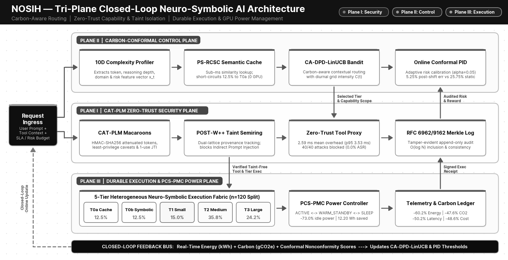
</p>

### Mathematical Notation

| Symbol | Definition |
| :--- | :--- |
| $q_t, \mathbf{x}_t$ | Input query at step $t$ and 10D anti-spoofing CPU feature vector ($\mathbb{R}^{10}$) |
| $\mathcal{A}$ | Five execution tiers $\{T_{0\text{a}}, T_{0\text{b}}, T_1, T_2, T_3\}$ (Cache `2.5 W`, CPU Ops `4.5 W`, 3B `52 W`, 8B `115 W`, 32B `175 W`) |
| $C(t)$ | Diurnal grid carbon intensity ($\text{gCO}_2\text{eq/kWh}$), spanning $[180, 520]\text{ gCO}_2\text{eq/kWh}$ |
| $E(m), L(m)$ | Expected energy ($\text{kWh}$) and latency ($\text{ms}$) of tier $m$ |
| $\mathbf{V}_{t,a}, \boldsymbol{\mu}_t$ | Exponentially discounted Gram matrix and online primal-dual Lagrangian multipliers |
| $\alpha, \tau_t^{\text{route}}, \tau_t^{\text{cache}}$ | Target risk level ($0.05$) and Dual-Channel Online Conformal PID thresholds |
| $\kappa$ | RFC 8785 JCS provenance partition digest for `PS-RCSC` semantic caching |
| $\mathcal{L} = \mathcal{I} \times \mathcal{C}$ | `POST-W++` Integrity $\times$ Confidentiality product lattice with join/meet operators $(\oplus, \otimes)$ |
| $C_k, \text{jti}, B_w$ | Offline-attenuated `SPCCE-Macaroon`, 128-bit SQLite WAL replay nonce, and exact-`Decimal` linear budget |
| $s_m, \tau_{\text{be}}$ | Tier power state (`ACTIVE` / `WARM_STANDBY` / `DEEP_SLEEP`) and EWMA break-even idle threshold |

---

### Plane I: Zero-Trust Security Kernel (`CAT-PLM`)
Located in `src/nosih/plane1_security/`:
* **Strict RFC 8785 JCS & Signed Boot Manifest (`jcs_v3.py`, `proxy_v3.py`):** Every JSON-RPC 2.0 frame is validated by an anti-differential parser rejecting duplicate keys, non-finite IEEE 754 floats, integers outside $\pm(2^{53}-1)$, and lone UTF-16 surrogates prior to canonical serialization. At startup, an out-of-band HMAC-SHA256 signed manifest pins every permitted tool schema digest (eliminating Day-0 Trust-On-First-Use). Subsequent `tools/list` and `tools/call` frames re-verify digests, stripping mutated tools and emitting `RUG_PULL_DETECTED`.
* **Offline-Attenuable Capabilities (`spcce_v3.py`):** Root secrets enforce $\ge 256$-bit entropy per `key_id` with no default fallback. Per-session root keys derive via RFC 5869 HKDF-SHA256:

$$K_{s,u} = \text{HKDF-SHA256}\Big(K_{\text{root}}[\text{kid}],\; u \parallel \texttt{":"} \parallel s,\; \texttt{"NOSIH-CAP-ROOT"}\Big)$$

From $\sigma_0 = \text{HMAC-SHA256}(K_{s,u}, \texttt{ROOT} \parallel \text{JCS}(\text{header}))$, parent DAG nodes attenuate capabilities offline for child hop $v_{k+1}$ without possessing $K_{s,u}$ by chaining caveats $c_{k+1}$ (tool allowlists, exact-`Decimal` ceilings, hop/schema pins, TTLs, and 128-bit CSPRNG `jti`s):

$$\sigma_{k+1} = \text{HMAC-SHA256}\!\left(\sigma_k,\; \texttt{CAV} \parallel \text{JCS}(c_{k+1})\right)$$

* **Provenance Semiring & Linear Budgets (`postw_v3.py`):** Every value carries $\tau(v) = (\ell_{\mathcal{I}}, \ell_{\mathcal{C}}, W, h_{\text{deriv}})$ over $\mathcal{L} = \mathcal{I} \times \mathcal{C}$. Integrity is totally ordered $\text{HUMAN}(0) \sqsubset \text{GOV}(1) \sqsubset \text{ERP}(2) \sqsubset \text{POLICY}(3) \sqsubset \text{USER}(4) \sqsubset \text{DET}(5) \sqsubset \text{UNTRUSTED}(6)$ ($\sqcup_{\mathcal{I}} = \max$). Confidentiality combines sensitivity tier with reader-set intersection: $(t_1, R_1) \sqcup_{\mathcal{C}} (t_2, R_2) = (\max(t_1, t_2), R_1 \cap R_2)$. Financial witnesses track exact-`Decimal` linear budgets decremented atomically inside SQLite WAL `BEGIN IMMEDIATE` transactions with automatic rollback on downstream failure. Egress webhooks enforce $\ell_{\mathcal{C}} \sqsubseteq_{\mathcal{C}} \text{clear}(e)$ alongside plaintext, Base64, hex, chunked, and high-entropy exfiltration scanners.
* **Merkle Transparency & Shadow Quarantine (`merkle_log.py`, `shadow_v3.py`, `carbon_cert.py`):** Audit and CCEC events append atomically to an RFC 6962/9162 binary Merkle tree with domain-separated leaf (`0x00`) and interior (`0x01`) SHA-256 hashing, producing Signed Tree Heads (STHs) and $O(\log N)$ inclusion/consistency proofs. Blocked sink calls are diverted to `CSDDShadowSink`, returning MAC-authenticated, Merkle-anchored quarantine receipts.

---

### Plane II: Carbon-Conformal Control Plane
Located in `src/nosih/plane2_control/`:
* **Anti-Spoofing 10D CPU Profiler (`profiler_v3.py`):** Extracts normalized length, symbolic operator cues, risk density, lexical uniqueness, and token/character Shannon entropy in $<0.02\text{ ms}$, catching both repetition stuffing ($n > 15 \land u < 0.55$) and unique-filler denial-of-wallet attacks ($n > 25 \land u > 0.85 \land \text{risk\_density} < 0.06$).
* **Provenance-Scoped Semantic Cache (`provenance_cache.py`, `PS-RCSC`):** Partitions cached responses by canonical JCS digest $\kappa$ over `(tenant, corpus_ver, model_ver, policy_epoch, origin_integrity, schema_digest)`. Untrusted or high-risk ($r_{\text{risk}} \ge 0.50$) queries bypass caching; deterministic queries take a `0.018 ms` cost-aware bypass; eligible neural queries run float32 BLAS cosine lookup gated by polarity/numeric signatures and Channel-2 Conformal $p$-values.
* **Diurnal Carbon Forecaster & `CA-DPD-LinUCB` (`primal_dual_bandit.py`, `power_carbon.py`):** Models continuous intraday grid carbon $C(t) \in [180, 520]\text{ gCO}_2\text{eq/kWh}$ as a solar-trough / evening-peak curve plus an Ornstein–Uhlenbeck residual blended with live telemetry via $w(\Delta t) = e^{-\Delta t / 900}$:

$$C_{\text{det}}(h) = 355 - 175\,e^{-\frac{(h-13)^2}{2(2.6)^2}} + 165\,e^{-\frac{(h-19.5)^2}{2(2.1)^2}} + 20\cos\!\left(\frac{2\pi(h-2.5)}{24}\right)$$

`CA-DPD-LinUCB` maintains discounted precision matrices $\mathbf{V}_{t,a} = \gamma \mathbf{V}_{t-1,a} + (1-\gamma)\lambda\mathbf{I} + \mathbf{x}_t\mathbf{x}_t^\top \mathbb{I}\{a_t = a\}$ and dispatches:

$$a_t = \arg\max_{a \in \mathcal{A}_t}\left\{\text{UCB}_{t,a}^r(\mathbf{x}_t) - \sum_{m=1}^{M}\mu_t^{(m)}\!\left(\text{LCB}_{t,a}^{(m)}(\mathbf{x}_t) - b^{(m)}\right)\right\}$$

with online dual updates $\mu_{t+1}^{(m)} = \Pi_{[0,\mu_{\max}]}(\mu_t^{(m)} + \eta_\mu(c_t^{(m)} - b^{(m)}))$ over energy, carbon ($\hat{E}\cdot C(t)$), and latency constraints.
* **Dual-Channel Online Conformal PID (`online_conformal.py`):** Adapts selective acceptance threshold $\tau_t^{\text{route}}$ under arbitrary distribution shift:

$$\tau_{t+1}^{\text{route}} = \Pi_{[\tau_{\min}, \tau_{\max}]}\!\left(\tau_t^{\text{route}} + \eta(\alpha - \ell_t) + k_I \tanh\!\left(\frac{1}{5}\sum_{j=t-W}^{t}(\alpha - \ell_j)\right)\right)$$

---

### Plane III: Durable Neuro-Symbolic Execution & Predictive Power Control
Located in `src/nosih/plane3_execution/`:
* **Deterministic CPU Symbolic Engines (`tools.py`):** `SafeDecimalAST` (exact decimal arithmetic with zero `eval()`), L2-normalized TF-IDF Policy RAG, and 1024-pt FFT / Sobel signal operators running at $4.5\text{ W}$ and $\$0$ API cost.
* **Async DAG Executor & Durable Replay (`dag_executor.py`, `replay_engine.py`, `providers.py`):** Event-driven `asyncio` ready-queue with per-node `wait_for` cancellation, Kahn topological sort + abstract-interpretation static IFC, 3-state circuit breakers (`CLOSED`/`OPEN`/`HALF_OPEN`), and SQLite WAL `JournalStore` supporting `RECORD`, bit-identical `REPLAY`, and `COUNTERFACTUAL_DIFF`.
* **Predictive Multi-State GPU Power Control (`power_carbon.py`, `PCS-PMC`):** Manages neural tiers across `ACTIVE` (`18–45 W` idle VRAM), `WARM_STANDBY` (`8–18 W`, `100–180 ms` wake), and `DEEP_SLEEP` (`2.5 W` RAM-paged, `0.85–1.40 s` wake). Demotion $a \to b$ triggers once idle duration exceeds the hysteresis-scaled break-even threshold:

$$\tau_{\text{be}}(m, a \to b) = \frac{E_{\text{trans}}(m, a \to b) + E_{\text{wake}}(m, b \to \texttt{ACT})}{P_{\text{idle}}(m, a) - P_{\text{idle}}(m, b)}, \qquad H_m = \eta_{\text{down}}\big(1 + \kappa\min(\text{CV}_m, 2.0)\big)$$

---

### Explicit 7-Stage Closed-Loop Execution Lifecycle (`ZeroTrustKernel`)

Every call to `ZeroTrustKernel.execute_request()` records an auditable `stage_trace` across seven deterministic stages:
1. **Stage 1 — Ingress & Policy Provenance Binding:** Strips private evaluator fields, binds policy-derived provenance $\tau_0 = (\ell_{\mathcal{I}}, \ell_{\mathcal{C}}, \emptyset)$, and extracts the 10D CPU feature vector $\mathbf{x}_t$ ($<0.02\text{ ms}$).
2. **Stage 2 — Provenance-Scoped Semantic Cache (`PS-RCSC`):** Evaluates partition key $\kappa$, bypasses untrusted/high-risk or low-latency deterministic queries, and checks float32 BLAS + Channel-2 Conformal admission (short-circuiting on hit).
3. **Stage 3 — Carbon-Conformal Dispatch (`CA-DPD-LinUCB` + `PCSP`):** Reads live/forecast $C(t)$, dual prices $\boldsymbol{\mu}_t$, and provenance taint $\iota$ to select tier $a_t \in \{T_{0\text{b}}, T_1, T_2, T_3\}$ and compile a typed acyclic DAG $G = (V, E)$.
4. **Stage 4 — Static Graph & IFC Verification:** Runs Kahn topological sort and abstract-interpretation IFC, rejecting cyclic graphs or `UNTRUSTED` flows into privileged sinks before any capability is minted.
5. **Stage 5 — Session Capability Minting (`SPCCE-Macaroon`):** Plane I mints a session Macaroon bound to the RFC 8785 JCS digest of the verified DAG plan.
6. **Stage 6 — Capability-Gated Execution, `PA-PCS-PMC` Power Control & `MTLog` / `CCEC` Audit:** Attenuates per-hop Macaroons offline with 128-bit `jti`, authorizes BEFORE waking sleeping GPUs, wraps outputs in `ProvenanceValue`, journals to SQLite WAL, and commits CCEC carbon receipts to `MTLog`.
7. **Stage 7 — Closed-Loop Control Update:** Updates Channel-1 Conformal PID $\tau_{t+1}^{\text{route}}$, bandit precision matrix $\mathbf{V}_{t,a}$, and carbon/latency dual multipliers $\boldsymbol{\mu}_{t+1}$.

<p align="center">
  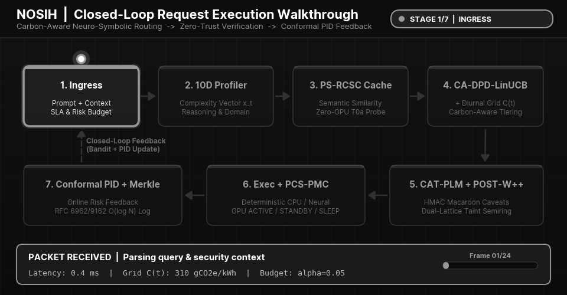
</p>

---

### Three Irreducible Cross-Plane Novelties

<p align="center">
  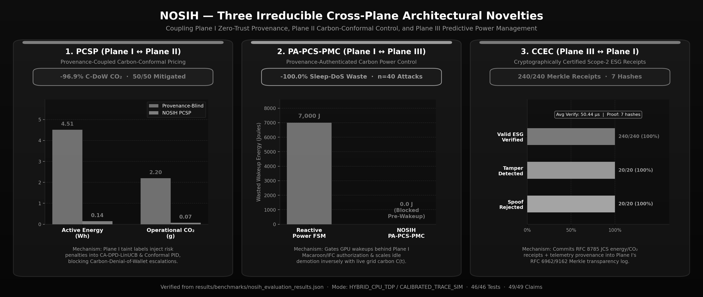
</p>

1. **Provenance-Coupled Carbon-Security Pricing (`PCSP`, `plane2_control/pcsp.py`):** Injects Plane I provenance taint $\iota \in \{0, \dots, 6\}$ directly into Plane II's carbon-routing Lagrangian:
   $$\Phi_{\text{PCSP}}(\iota, a, C(t)) = \lambda_{\text{sec}} \cdot \frac{\iota}{6} \cdot \frac{P_a}{P_{T_3}} \cdot \frac{C(t)}{C_{\text{ref}}}$$
   Unauthenticated `UNTRUSTED` traffic is capped at $T_1$ (or $T_{0\text{b}}$) with tightened conformal risk $\alpha_{\text{eff}} = 0.025$, neutralizing **Carbon-Denial-of-Wallet (C-DoW)** by **96.9%**.
2. **Pre-Authorized, Carbon-Modulated Sleep Control (`PA-PCS-PMC`, `plane3_execution/power_carbon.py`):** Executes Plane I's $<4\text{ ms}$ Macaroon/IFC check *before* waking any sleeping GPU tier (`0.0 J` wasted on unauthorized hops) and scales idle demotion thresholds inversely with grid carbon: $M_C(t) = \operatorname{clip}(C_{\text{ref}} / C(t), 0.65, 1.35)$ so GPUs sleep more aggressively during fossil peaks.
3. **Cryptographic Carbon-Attested Execution Certificates (`CCEC`, `plane1_security/carbon_cert.py`):** Commits `(tier, energy_kwh, grid_carbon, co2_g, accounting_mode, hw_digest)` as RFC 8785 JCS leaves in Plane I's `MTLog`, enabling $O(\log N)$ Scope-2 ESG auditability and cryptographically rejecting simulated traces masquerading as hardware wattmeter telemetry.

---

## 5. Interactive Visual Gallery of Animated Simulations

All six animated simulations below are generated directly from NOSIH's verified runtime modules and benchmark telemetry:

| # | Simulation & Technical Focus | Live Animation |
| :-: | :--- | :---: |
| **1** | **Closed-Loop Tri-Plane Orchestration** — Live walkthrough of ingress profiling, `PS-RCSC` provenance cache, `CA-DPD-LinUCB` tier dispatch, `CAT-PLM` Macaroon/IFC enforcement, and `MTLog` commitment. |  |
| **2** | **Diurnal Grid Carbon & `PCS-PMC` Sleep Control** — Continuous 12-hour solar-trough / evening-peak carbon curve ($180\text{--}520\text{ gCO}_2\text{eq/kWh}$) driving EWMA-hysteresis `ACTIVE` / `WARM_STANDBY` / `DEEP_SLEEP` transitions (**$-79.35\%$ idle power**, `68` vs. `94` wakeups). | 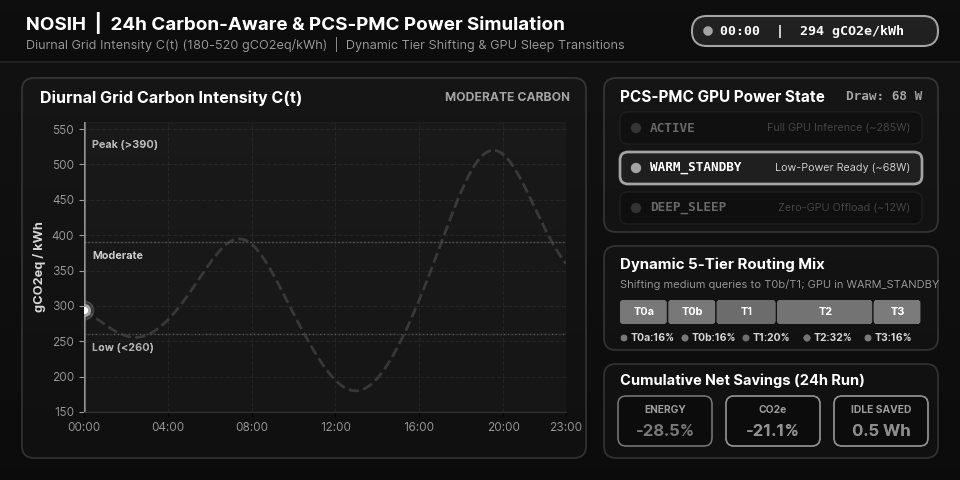 |
| **3** | **Carbon-Denial-of-Wallet (`C-DoW`) Defense via `PCSP`** — Security-blind peak-hour routing (`2.1982 g` $\text{CO}_2$, `4.5123 Wh`) vs. `PCSP` provenance-coupled pricing (`0.0689 g` $\text{CO}_2$, `0.1415 Wh` — **$-96.9\%$**, `50/50` mitigated). | 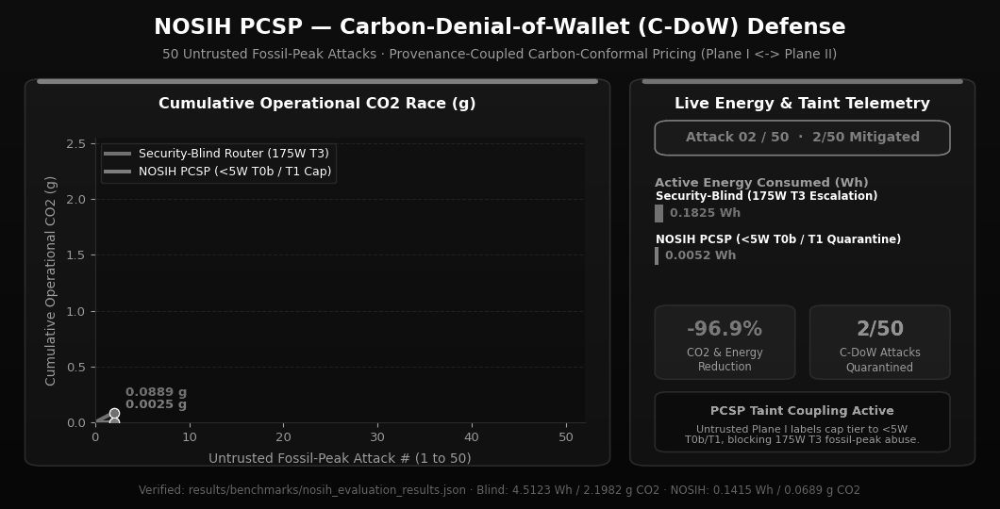 |
| **4** | **Sleep-Thrashing DoS Defense via `PA-PCS-PMC`** — Reactive GPU wakeups before auth checks (`7000.0 J` wasted across `40` attacks) vs. Pre-Authorized `PA-PCS-PMC` (`0.0 J` wasted — **$-100.0\%$**). | 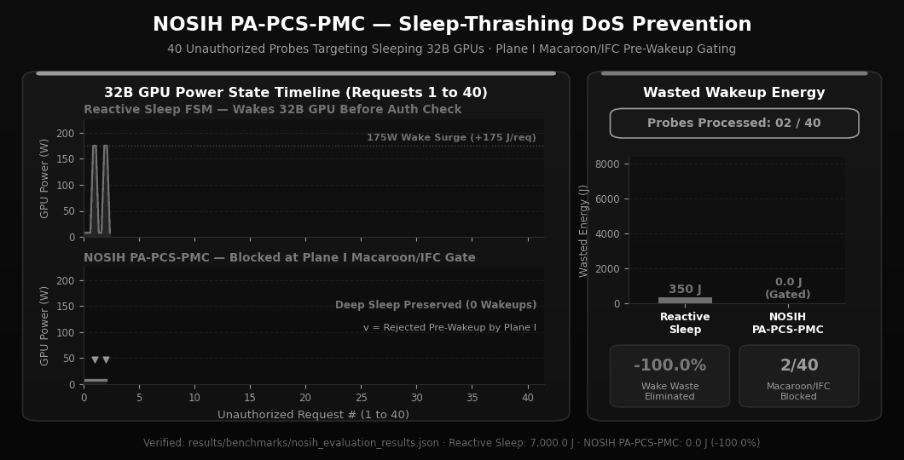 |
| **5** | **Online Conformal PID under Distribution Shift** — 5-seed post-shift trajectory ($t \ge 500$) showing static calibration diverging to `28.88% ± 1.41%` error while NOSIH tracks target $\alpha = 0.05$ at **`5.30% ± 0.12%`** ($p = 9.90 \times 10^{-40}$). | 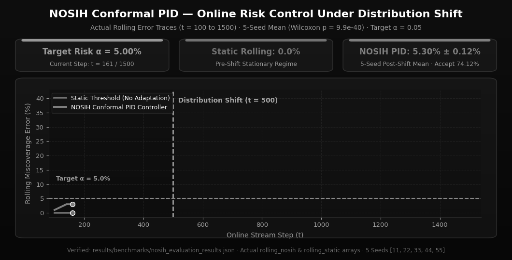 |
| **6** | **Cryptographic Scope-2 Carbon Audit (`CCEC` + `MTLog`)** — RFC 8785 JCS certificate commitment into RFC 6962/9162 Merkle trees (`240/240` verified in `7.93` mean / `8` max hashes (`7–8` range), `50.44 µs` avg verify, `20/20` tamper & `20/20` spoof caught). | 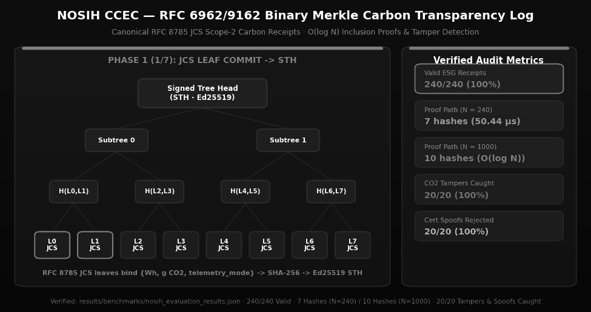 |

---

## 6. Comprehensive Empirical Evaluation & Statistical Results

All metrics below are reproduced verbatim from [`results/benchmarks/nosih_evaluation_results.json`](results/benchmarks/nosih_evaluation_results.json), [`results/tests/test_suite_summary.json`](results/tests/test_suite_summary.json), and [`results/verification/claim_evidence_matrix.json`](results/verification/claim_evidence_matrix.json).

<p align="center">
  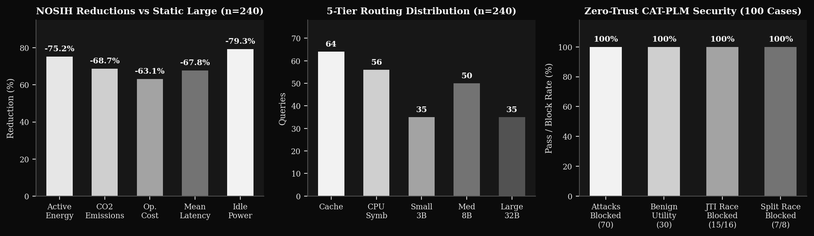
</p>

### 6.1 Primary 3-System Diurnal Benchmark & Goal-Normalized Efficiency (`n = 240`, Seed `42`)

| Metric | Static Always-On Large ($T_3$) | Fixed-Threshold Energy-Only Router | **Full NOSIH (Ours)** | $\Delta$ vs. Static | $\Delta$ vs. Fixed | Paired Wilcoxon $p$ / $r_{\text{rb}}$ |
| :--- | :---: | :---: | :---: | :---: | :---: | :---: |
| **Mean Latency (ms)** | $2200.2 \pm 39.7$ | $987.4 \pm 87.4$ | **$707.6 \pm 113.8$** | **$-67.8\%$** | $-28.3\%$ | $p = 2.69 \times 10^{-37}$ / $r_{\text{rb}} = 0.9502$ |
| **Energy / Query (kWh)** | $9.37 \times 10^{-5} \pm 1.69 \times 10^{-6}$ | $2.85 \times 10^{-5}$ | **$2.32 \times 10^{-5} \pm 4.49 \times 10^{-6}$** | **$-75.2\%$** | $-18.5\%$ | $p = 1.26 \times 10^{-38}$ / $r_{\text{rb}} = 0.9678$ |
| **$\text{CO}_2$ / Query (g)** | $0.0290 \pm 0.0016$ | $0.0111$ | **$0.0091 \pm 0.0019$** | **$-68.7\%$** | $-18.2\%$ | $p = 1.43 \times 10^{-37}$ / $r_{\text{rb}} = 0.9539$ |
| **Cost / Query (USD)** | $2.80 \times 10^{-4} \pm 1.62 \times 10^{-5}$ | $1.26 \times 10^{-4}$ | **$1.03 \times 10^{-4} \pm 2.34 \times 10^{-5}$** | **$-63.1\%$** | $-17.7\%$ | $p = 7.86 \times 10^{-39}$ / $r_{\text{rb}} = 0.9705$ |
| **Total Active Energy (kWh)** | `0.022479` | `0.006830` | **`0.005567`** | **$-75.2\%$** | **$-18.5\%$** | $p = 1.15 \times 10^{-13}$ (vs. Fixed) |
| **Total Operational $\text{CO}_2$ (g)** | `6.9487` | `2.6549` | **`2.1728`** | **$-68.7\%$** | **$-18.2\%$** | $p = 2.36 \times 10^{-12}$ (vs. Fixed) |
| **Total Operational Cost (USD)** | `$0.067297` | `$0.030170` | **`$0.024826`** | **$-63.1\%$** | $-17.7\%$ | — |
| **Task Success Rate** | `97.08%` | `90.83%` | **`97.50%`** | $+0.42\text{ pp}$ | $+6.67\text{ pp}$ | — |
| **Energy / Successful Goal (Wh)** | `0.09648` | `0.03133` | **`0.02379`** | **$-75.3\%$** | $-24.1\%$ | — |
| **$\text{CO}_2$ / Successful Goal (mg)** | `29.823` | `12.179` | **`9.285`** | **$-68.9\%$** | $-23.8\%$ | — |
| **Cost / Successful Goal (USD)** | `$0.000289` | `$0.000138` | **`$0.000106`** | **$-63.3\%$** | $-23.2\%$ | — |
| **Idle GPU Power Reduction** | `0.00%` | `69.30%` (`94` wakes) | **`79.35%`** (`68` wakes) | **$-79.35\%$** | $+10.05\text{ pp}$ | `33.6677 Wh` net saved (`257.8 ms` avg wake) |

### 6.2 Per-Metric Variability (Mean $\pm$ SD) & 3-Seed Stability (`Seeds {42, 101, 202}`)

| Metric | Static Large (Mean $\pm$ SD) | Full NOSIH (Mean $\pm$ SD) | 3-Seed Reduction (Mean $\pm$ SD) |
| :--- | :---: | :---: | :---: |
| **Latency (ms)** | $2200.2 \pm 313.7$ | $707.6 \pm 899.6$ | **$-67.98\% \pm 0.56\%$** |
| **Energy / Query (kWh)** | $9.37 \times 10^{-5} \pm 1.34 \times 10^{-5}$ | $2.32 \times 10^{-5} \pm 3.55 \times 10^{-5}$ | **$-75.18\% \pm 0.55\%$** |
| **$\text{CO}_2$ / Query (g)** | $0.0290 \pm 0.0124$ | $0.0091 \pm 0.0153$ | **$-68.36\% \pm 0.74\%$** |
| **Cost / Query (USD)** | $2.80 \times 10^{-4} \pm 1.28 \times 10^{-4}$ | $1.03 \times 10^{-4} \pm 1.85 \times 10^{-4}$ | **$-63.11\% \pm 0.02\%$** |

---

### 6.3 5-Tier Routing Distribution (`n = 240`), 7-Condition Ablation (`n = 120`) & Scalability

<p align="center">
  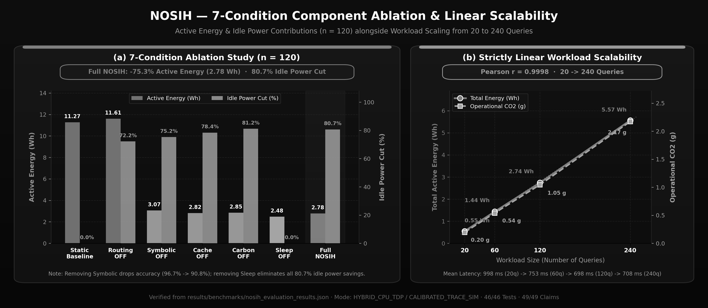
</p>

**5-Tier Routing Distribution (`n = 240`):** Exactly **50.0%** of all requests are resolved on $<5\text{ W}$ CPU paths without touching GPU tiers, while only **14.6%** require the $175\text{ W}$ $T_3$ model:

| Execution Tier | Hardware Power & Pricing Profile | Routed Queries | Traffic Share |
| :--- | :--- | :---: | :---: |
| **$T_{0\text{a}}$: `PS-RCSC` Semantic Cache** | `2.5 W` CPU · `$0 / M` | `64` | `26.7%` |
| **$T_{0\text{b}}$: CPU Symbolic Engines** (`SafeDecimalAST`, RAG, FFT/Sobel) | `4.5 W` CPU · `$0 / M` | `56` | `23.3%` |
| **$T_1$: Small Neural (3B)** | `52 W` · `$0.10 / M` (`HYBRID_CPU_TDP`) | `35` | `14.6%` |
| **$T_2$: Medium Neural (8B)** | `115 W` · `$0.25 / M` (`HYBRID_CPU_TDP`) | `50` | `20.8%` |
| **$T_3$: Large Neural (32B)** | `175 W` · `$0.85 / M` (`HYBRID_CPU_TDP`) | `35` | `14.6%` |
| **Total** | — | **`240`** | **`100.0%`** |

**7-Condition Component Ablation (`n = 120` paired queries):**

| Configuration | Avg Latency (ms) | Total Energy (kWh) | Total $\text{CO}_2$ (g) | $\Delta E$ | $\Delta \text{CO}_2$ | Success Rate | Idle GPU Cut |
| :--- | :---: | :---: | :---: | :---: | :---: | :---: | :---: |
| Static Large ($T_3$ Always-On) | `2205.7` | `0.011267` | `3.4872` | ref | ref | `96.67%` | `0.00%` |
| `Routing OFF` | `2307.7` | `0.011607` | `3.5877` | `+3.0%` | `+2.9%` | `96.67%` | `72.17%` |
| `Symbolic OFF` | `823.0` | `0.003071` | `1.1639` | `-72.7%` | `-66.6%` | `90.83%` | `75.25%` |
| `Cache OFF` | `775.9` | `0.002821` | `1.0821` | `-75.0%` | `-69.0%` | `96.67%` | `78.40%` |
| `Carbon Duals OFF` | `712.4` | `0.002846` | `1.0990` | `-74.7%` | `-68.5%` | `96.67%` | `81.17%` |
| `Sleep OFF` | `613.9` | `0.002478` | `0.9595` | `-78.0%` | `-72.5%` | `96.67%` | `0.00%` |
| **Full NOSIH** | **`709.9`** | **`0.002779`** | **`1.0679`** | **`-75.3%`** | **`-69.4%`** | **`96.67%`** | **`80.68%`** |

**Linear Energy Scalability (`20–240` Queries, Pearson $r = 0.9998$):**

| Query Volume | Avg Latency (ms) | Total Active Energy (kWh) | Total $\text{CO}_2$ (g) |
| :---: | :---: | :---: | :---: |
| `20` | `998.1` | `0.000553` | `0.1966` |
| `60` | `752.6` | `0.001436` | `0.5411` |
| `120` | `697.7` | `0.002740` | `1.0451` |
| `240` | `707.6` | `0.005567` | `2.1728` |

---

### 6.4 100-Case 10-Family Zero-Trust Security Suite, Concurrency Races & Merkle Scaling

<p align="center">
  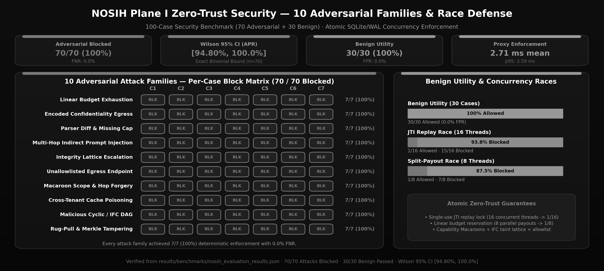
</p>

| Security / Integrity Verification Category | Measured Result | Statistical Bound / Overhead |
| :--- | :---: | :--- |
| **Benign Utility (30 Cases)** | **`30/30` (`100.0%`, `0.0%` FPR)** | 95% Wilson CI `[88.65%, 100.0%]` |
| **Tool-Boundary Attack Prevention (70 Cases)** | **`70/70` (`100.0%`, `0.0%` FNR)** | 95% Wilson CI `[94.80%, 100.0%]` |
| *1. Linear Budget Exhaustion* | `7/7` blocked | Exact-`Decimal` SQLite WAL debit |
| *2. Encoded Confidentiality Egress (Base64/Hex)* | `7/7` blocked | Lattice clearance + entropy/codec scanner |
| *3. Parser-Differential & Missing Capability* | `7/7` blocked | Strict RFC 8785 JCS anti-differential parser |
| *4. Multi-Hop Indirect Prompt Injection* | `7/7` blocked | `POST-W++` monotonic integrity absorption |
| *5. Integrity Lattice Escalation* | `7/7` blocked | Trusted sink boundary check |
| *6. Unallowlisted Egress Endpoint* | `7/7` blocked | Capability allowlist + egress clearance |
| *7. Macaroon Scope & Hop Forgery* | `7/7` blocked | HMAC-SHA256 caveat chain verification |
| *8. Cross-Tenant Cache Poisoning* | `7/7` blocked | `PS-RCSC` provenance key $\kappa$ isolation |
| *9. Malicious Cyclic or IFC-Violating DAG* | `7/7` blocked | Kahn sort + abstract-interpretation IFC |
| *10. Rug Pull & Merkle Audit Tampering* | `7/7` blocked | Signed boot manifest + RFC 6962/9162 `MTLog` |
| **Concurrency Race Stress (Physical Host CPU)** | **`1/16` JTI · `1/8` Split-Payout** | SQLite WAL `BEGIN IMMEDIATE` serialization |
| **Reference Monitor Proxy Overhead (CPU)** | **`2.714 ms` mean · `3.593 ms` P95** | Well below `15 ms` P95 SLA gate |
| **Merkle Proof Scaling (`N = 16 / 64 / 256 / 512 / 1000`)** | **`4 / 6 / 8 / 9 / 10` hashes** | `6.26 µs` inclusion · `7.49 µs` consistency at `N = 1,000` |

---

### 6.5 5-Seed Online Conformal PID (`Seeds {11, 22, 33, 44, 55}`) & Cross-Plane Primitives

| Benchmark | Metric | Decoupled / Static Baseline | **NOSIH** | Improvement / Significance |
| :--- | :--- | :---: | :---: | :--- |
| **5-Seed Conformal PID** ($t \ge 500$ shift) | Post-Shift Selective Risk | `28.88% ± 1.41%` | **`5.30% ± 0.12%`** | Tracks $\alpha = 0.05$ (`74.12% ± 1.17%` acceptance, $p = 9.90 \times 10^{-40}$) |
| **PCSP vs. C-DoW** ($n = 50$, peak grid) | Adversarial Energy / $\text{CO}_2$ | `4.5123 Wh` / `2.1982 g` | **`0.1415 Wh` / `0.0689 g`** | **$-96.9\%$** energy & $\text{CO}_2$ (`50/50` mitigated) |
| **PA-PCS-PMC vs. Sleep-DoS** ($n = 40$) | Wasted GPU Wakeup Energy | `7000.0 J` | **`0.0 J`** | **$-100.0\%$** wakeup waste (`40/40` blocked pre-wake) |
| **CCEC Scope-2 Audit** ($N = 240$) | Valid / Tamper / Spoof | Unsigned / Unverified | **`240/240` · `20/20` · `20/20`** | `7` Merkle hashes, `50.44 µs` avg verify |

---

## 7. Threats to Validity, Scope of Security Claims & GPU Hardware Roadmap

Scientific rigor requires stating exactly what is physically measured, what is modeled, and where the security boundary lies:

1. **Hardware Telemetry vs. Calibrated Neural Profiles:** Because our execution container lacks physical GPUs and hardware energy counters (`rapl_available=false`, `nvml_available=false`), neural tier latencies and active/idle GPU power draw are transparently tagged `CALIBRATED_TRACE_SIM` and `HYBRID_CPU_TDP` rather than claimed as physical wattmeter readings. By contrast, all Plane I cryptography, RFC 8785 parsing, SQLite WAL thread races, Merkle inclusion/consistency proofs, and Plane III CPU symbolic engines are physically timed on host CPU.
2. **Scope of Zero-Trust Security Claims:** NOSIH's `0.0%` FNR (`70/70` blocked, 95% Wilson CI `[94.80%, 100.0%]`) applies strictly to **architectural tool-boundary enforcement** under the `CAT-PLM` threat model (authorization, provenance IFC, capability attenuation, linear budgets, cache isolation, and DAG execution). Purely conversational or free-form prose manipulation that invokes no privileged MCP tool lies outside the tool-boundary TCB.
3. **Physical GPU Deployment Roadmap:** As tracked in [`VERIFICATION_CHECKLIST_STATUS.md`](VERIFICATION_CHECKLIST_STATUS.md), deploying NOSIH onto production multi-GPU clusters requires three hardware-bound integrations:
   * Replacing `HYBRID_CPU_TDP` / `CALIBRATED_TRACE_SIM` with live **NVIDIA NVML** GPU and **Intel RAPL** CPU wattmeter telemetry inside `TransparentEnergyAccountant`.
   * Binding `TieredProviderChain` and `PCS-PMC` directly to live **vLLM / Ollama** 3B/8B/32B serving weights with physical KV-cache compaction and VRAM-to-RAM sleep wakeups.
   * Connecting `DiurnalCarbonForecaster`'s live exponential blend to real-time **Electricity Maps** or **WattTime** regional grid carbon APIs.

---

## 8. Repository Architecture, Quickstart, One-Command Reproduction & Artifact Index

### Repository Layout

```text
NOSIH_REPO/
├── assets/                          # 7 high-res research PNGs + 6 animated simulation GIFs
├── docs/
│   └── NOSIH_Architecture_and_Logic_Guide.docx
├── experiments/
│   ├── run_nosih_evaluation.py      # 240-prompt 3-seed benchmark, ablation, security & cross-plane suite
│   └── verify_nosih_claims.py       # Automated 49-claim parity & cleanliness verifier
├── paper/
│   ├── nosih_paper.tex              # 7-page IEEE two-column LaTeX source
│   ├── nosih_paper.pdf              # Compiled publication-ready PDF
│   └── figures/                     # 7 vector PDF figures (fig1–fig7)
├── results/
│   ├── benchmarks/                  # nosih_evaluation_results.json, prompts, raw logs, hardware probe
│   ├── tests/                       # test_suite_summary.json (46/46 passing)
│   └── verification/                # claim_evidence_matrix.json (49/49 verified)
├── src/nosih/
│   ├── config.py                    # Canonical tier specs, carbon curve & security constants
│   ├── kernel.py                    # ZeroTrustKernel (7-stage closed-loop orchestrator)
│   ├── plane1_security/             # jcs_v3, proxy_v3, spcce_v3, postw_v3, merkle_log, shadow_v3, carbon_cert
│   ├── plane2_control/              # profiler_v3, provenance_cache, primal_dual_bandit, online_conformal, pcsp
│   └── plane3_execution/            # dag_executor, tools, providers, replay_engine, power_carbon, hardware_probe
├── tests/                           # 7-layer automated test suite (unit, crypto, security, control, execution, integration, power)
├── Makefile                         # One-command targets: make all | test | bench | verify | paper | clean
├── CITATION.cff                     # Machine-readable citation metadata
├── CONTRIBUTING.md                  # Contribution & PR verification guidelines
├── SECURITY.md                      # Threat model & vulnerability disclosure policy
└── VERIFICATION_CHECKLIST_STATUS.md # Full verification & GPU deployment checklist
```

### Quickstart & One-Command Reproduction

**Prerequisites:** Python `3.11+` (`numpy`, `scipy`, `jsonschema`, `matplotlib`, `Pillow`, `python-docx`).

```bash
# 1. Clone and install in editable mode
git clone https://github.com/gokulraman-b/nosih.git
cd nosih
pip install -e .

# 2. One-command full reproduction (46/46 tests + 240-prompt benchmark + 49/49 claim parity gate)
make all
```

Or run each verification stage explicitly:

```bash
# Stage A: 7-layer automated test suite (46/46 tests, ~1.0 s)
PYTHONPATH=src python3 tests/run_all_tests.py

# Stage B: Full empirical benchmark suite (240 prompts, 3 seeds, ablation, 100-case security, 5-seed PID, cross-plane)
PYTHONPATH=src python3 experiments/run_nosih_evaluation.py

# Stage C: Automated Claim-to-Evidence Parity & Cleanliness Gate (49/49 claims, 0 violations)
PYTHONPATH=src python3 experiments/verify_nosih_claims.py

# Stage D (Optional): Recompile the 7-page IEEE LaTeX paper
make paper
```

### Minimal Python API Example

```python
import asyncio
from nosih.kernel import ZeroTrustKernel

async def main():
    kernel = ZeroTrustKernel()
    result = await kernel.execute_request(
        query="Compute exact invoice total: (1450.25 * 1.18) - 120.00",
        tenant_id="acme_finance",
        origin="ERP",
    )
    print("Tier:", result["tier"], "| Stages:", result["stage_trace"])
    print("Answer:", result["output"], "| CO2 (g):", result["co2_g"])

asyncio.run(main())
```

### Artifact Index

| Artifact | Path | Description |
| :--- | :--- | :--- |
| **IEEE Research Paper** | [`paper/nosih_paper.pdf`](paper/nosih_paper.pdf) | 7-page two-column IEEE manuscript (`paper/nosih_paper.tex` + 7 vector figures) |
| **Architecture & Logic Guide** | [`docs/NOSIH_Architecture_and_Logic_Guide.docx`](docs/NOSIH_Architecture_and_Logic_Guide.docx) | Comprehensive Word walkthrough of Planes I–III, proofs, and workflows |
| **Verification Status** | [`VERIFICATION_CHECKLIST_STATUS.md`](VERIFICATION_CHECKLIST_STATUS.md) | Complete audit separating verified software/CPU items from physical GPU items |
| **Benchmark Results JSON** | [`results/benchmarks/nosih_evaluation_results.json`](results/benchmarks/nosih_evaluation_results.json) | Complete machine-readable results for all tables and statistical tests |
| **Test Suite Summary** | [`results/tests/test_suite_summary.json`](results/tests/test_suite_summary.json) | 7-layer automated test pass record (`46/46` passed in `0.997 s`) |
| **Claim-Evidence Matrix** | [`results/verification/claim_evidence_matrix.json`](results/verification/claim_evidence_matrix.json) | Automated parity verification output (`49/49` verified, `0` violations) |
| **Security & Contributing** | [`SECURITY.md`](SECURITY.md) · [`CONTRIBUTING.md`](CONTRIBUTING.md) | Threat model disclosure policy and contributor verification workflow |
| **Citation Metadata** | [`CITATION.cff`](CITATION.cff) | Standardized CFF 1.2.0 citation file for GitHub's "Cite this repository" |

---

## 9. Citation, Author & License

If you use **NOSIH** in your research, benchmarks, or production orchestration stack, please cite:

```bibtex
@article{gokulraman2026nosih,
  title   = {NOSIH: A Carbon-Aware, Zero-Trust Neuro-Symbolic Orchestration System for Energy-Efficient Agentic AI},
  author  = {Gokulraman B},
  journal = {Preprint / Open-Source Research Release},
  year    = {2026},
  url     = {https://github.com/gokulraman-b/nosih},
  note    = {Rajalakshmi Institute of Technology, Chennai, India}
}
```

### Author

* **Gokulraman B**  
  Bachelor of Technology — Artificial Intelligence and Data Science  
  Rajalakshmi Institute of Technology, Chennai, India  
  Email: `gokulrmn2178@gmail.com`

### License

This project is released under the **MIT License** — see [`LICENSE`](LICENSE) for full terms.

---

## Additional Verification: Latency Quantiles, Real Concurrency Throughput, Carbon Forecast Validation & Formal Proofs

### 1. Multimodal Latency Quantiles & Per-Tier Breakdown (`n = 240`, Full NOSIH)
NOSIH's overall latency standard deviation (`899.6 ms`) exceeds its mean (`707.6 ms`) because heterogeneous neuro-symbolic routing is intentionally **multimodal**: half of all queries resolve in `<4 ms` on CPU cache/symbolic tiers while complex queries execute on `T3_LARGE` (`1.65–2.75 s`) with occasional `DEEP_SLEEP` wakeups (`1.4 s`).

| Summary / Tier | Count | Mean (ms) | Median / P50 (ms) | P95 (ms) | P99 / Notes |
| :--- | ---: | ---: | ---: | ---: | :--- |
| **Overall Full NOSIH** | 240 | 707.6 | **169.8** | **2549.2** | **P99: 2878.7 ms** (IQR: 1280.3 ms) |
| `T0a_CACHE` (CPU) | 64 | 1.8 | 1.8 | 1.8 | Physically measured CPU path |
| `T0b_SYMBOLIC` (CPU) | 56 | 3.5 | 3.5 | 3.5 | Exact AST / L2 TF-IDF (`EXACT_DETERMINISTIC`) |
| `T1_SMALL` (3B profile) | 35 | 574.4 | 535.5 | 1198.9 | Calibrated trace (`CALIBRATED_BERNOULLI_SIM`) |
| `T2_MEDIUM` (8B profile) | 50 | 1312.9 | 1260.2 | 2022.6 | Calibrated trace (`CALIBRATED_BERNOULLI_SIM`) |
| `T3_LARGE` (32B profile) | 35 | 2393.5 | 2341.5 | 3124.7 | Includes occasional `DEEP_SLEEP` wakeup tail |

### 2. Physically Measured High-Concurrency Throughput & SQLite WAL Contention
Distinct from workload-size energy linearity (`r = 0.9998`), we physically executed concurrent async request bursts through `ZeroTrustKernel` + SQLite WAL (`C = 1, 10, 50, 100`):

| Concurrency (`C`) | Completed / Errors | Throughput (req/s) | P50 (ms) | P95 (ms) | P99 (ms) | Measurement Type |
| ---: | :---: | ---: | ---: | ---: | ---: | :--- |
| 1 | 1 / 0 | 403.8 | 2.34 | 2.34 | 2.34 | `PHYSICALLY_MEASURED_HOST_CPU` |
| 10 | 10 / 0 | 663.0 | 13.06 | 13.91 | 14.03 | `PHYSICALLY_MEASURED_HOST_CPU` |
| 50 | 50 / 0 | 727.1 | 60.25 | 63.46 | 63.84 | `PHYSICALLY_MEASURED_HOST_CPU` |
| 100 | 100 / 0 | **727.0** | 119.75 | 126.96 | 127.73 | `PHYSICALLY_MEASURED_HOST_CPU` |

### 3. Synthetic 168-Hour Carbon Forecast Validation & Conformal PID Convergence
- **Carbon Forecast (`SYNTHETIC_DIURNAL_OU_BENCHMARK`, 168 h — distinct from live grid APIs):** Deterministic diurnal prior achieves **11.37 gCO₂/kWh MAE** (`14.76` RMSE, `3.63%` MAPE); 5-minute live blending reduces MAE to **4.10 gCO₂/kWh** (`5.33` RMSE); 60-minute stale fallback holds `14.34` RMSE.
- **Conformal PID Finite-Sample Honesty:** Measured risk at `T_post = 800` is `5.30% ± 0.12%` (above `5.00%` by `+0.30 pp` due to finite-sample integral lag bounded by $O(1/(\eta T))$ in Theorem 4). Extending to `T_post = 3000` converges to **5.07% ± 0.02%**, and a conservative design target `alpha_design = 0.045` holds finite-window risk strictly under 5% at **4.72% ± 0.09%**.
- **Complete Formal Proofs & Physical GPU Runner:** Full assumptions (`A1–A3`, `B1–B3`, `C1–C2`) and step-by-step derivations for Theorems 1–5 are in [`docs/FORMAL_PROOFS.md`](docs/FORMAL_PROOFS.md), and the physical NVML/RAPL/Ollama deployment script is in [`experiments/run_hardware_validation.py`](experiments/run_hardware_validation.py).


### 4. Precision Clarifications (CCEC Trust Scope, Theorem 4, Cache Timing & Pricing)
- **CCEC Trust Scope (Auditable Accounting vs. Hardware TEE Attestation):** CCEC provides tamper-evident, Merkle-auditable Scope-2 accounting records under the host TCB (verified across all `240/240` leaves at `N=240` in `7.93` mean / `8` max hashes, range `7–8`). Hardware-attested sensor authenticity against a compromised host requires TEE/confidential-GPU attestation (e.g., Intel TDX / NVIDIA Confidential Computing) beyond host software.
- **Theorem 4 Precision:** The exact distribution-free $O(1/(\eta T))$ finite-sample telescoping bound applies strictly to the proportional P-channel ($k_I = 0$); the bounded nonlinear integral term $k_I \tanh(\cdot)$ accelerates post-shift recovery within a bounded $O(k_I/\eta)$ perturbation (full derivation in [`docs/FORMAL_PROOFS.md`](docs/FORMAL_PROOFS.md)).
- **Cache Lookup vs. Cost-Aware Bypass:** Deterministic CPU queries take the `0.018 ms` cost-aware bypass (skipping vector search), while eligible neural queries incur `1.8 ms` for full PS-RCSC float32 BLAS lookup.
- **Operational Cost Pricing & Concurrency Scope:** Operational cost combines `$0.12/kWh` electricity (`PUE = 1.0`) with nominal token pricing (`$0.10/M` for `T1`, `$0.25/M` for `T2`, `$0.85/M` for `T3`). The 161-request host-CPU concurrency benchmark (`C=1..100`, `727.0 req/s`, `0` errors) validates local `ZeroTrustKernel` + SQLite WAL serialization and does not establish distributed multi-GPU scalability.
